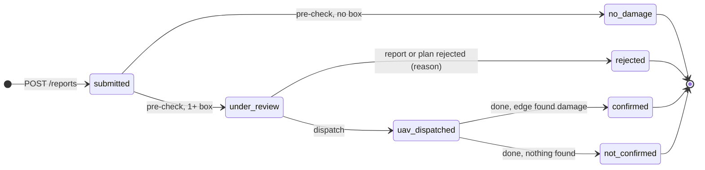

# Requirements: Smart City UAV for Pothole Detection (prototype)

COS40007 Group 1. Draft 0.3, 2026-11-05 (resident pages moved under `/resident`; contract decisions in
section 13; change log in section 15). Use cases: [use-cases.md](use-cases.md).

Sources, in order: `docs/prototype-plan.md`; `README.md`; `backend/app/schemas.py`, `backend/app/models.py`,
`backend/app/routers/*.py`, `frontend/lib/types.ts`, `frontend/lib/api.ts`; the Task 1 report facts restated in
the plan (user stories, activity diagram); the lead's decisions after draft 0.1. The Task 1 PDF is **not** in the
repo, so the user-story wording and acceptance criteria in section 4.2 are reconstructed (see A-01).

## 1. Purpose

A resident pins a pothole on a map and sends a photo. An AI pre-check runs. A UAV monitor reviews the report,
approves a flight plan, the UAV flies and its edge device confirms the damage, and the dashboard shows the
result. This document lists what the **working prototype** of that flow must do.

## 2. Scope

### 2.1 In scope

| # | Item |
|---|---|
| S-01 | Resident use cases: resident home, report a pothole (pin + photo + pre-check result), track my reports, browse my photo history. |
| S-02 | UAV monitor use cases: report queue on a map, review a report, review a flight plan, dispatch and track the UAV live, request the live camera. |
| S-03 | Easy sign-in (role + name, no password) and quick role switch. |
| S-04 | Mock FastAPI backend: real endpoints, SQLite, seed data. Data is seeded on first start and on "Reset demo", and survives server restarts. |
| S-05 | Telemetry ingest endpoint for the real drone JSON (so a real drone can plug in later). |
| S-06 | Clean, light, map-first web UI (Next.js) that works on desktop and phone. |

### 2.2 Mocked in the prototype

| Part | Real system (Task 1) | Prototype |
|---|---|---|
| AI pre-check | YOLO FP32 on the server (`services/detector.py`) | `MockDetector` (`app/services/mock_detector.py`): same `predict()` shape, result fixed by the file hash, about 25% "no damage", else 1-3 boxes, `deployment="server-fp32"`, `model_version="mock-0.1"` |
| Flight planner | Route planner | `FlightPlanner.propose()`: takeoff at home, fly to target, 8-point survey circle, return, land |
| UAV flight | Real drone | `sim/mock_flight.py`: time-based flight of 45 s, computed on each read (no background job) |
| Edge device | Jetson / Pi INT8 model on the UAV | Fake `jetson-int8` detections near the target, about 80% confirm, deterministic |
| Live camera | HLS / WebRTC stream | `CameraSession` with `stream_url = null`; UI shows a simulated feed (a road photo + HUD + "SIMULATED") |
| Seed data | Real reports | `backend/mock/seed.json` with real JPEG pothole photos from the user (`pothole-1.jpg` to `pothole-4.jpg`, `image_size` per report). The `no_damage` seed uses `clean-road.svg` (no boxes) until the user supplies a clean-road photo. Seed boxes are fixed data, not model output; they were checked against each photo, and seeding fails on a box outside its image. |
| Login | Real accounts | Role + name in browser `localStorage`, no password, no server session |

### 2.3 Out of scope

- Real model, training, threshold tuning, model registry, drift reports, retraining (MLOps).
- Real UAV control, edge hardware, real video streaming, return-home or abort commands.
- 3D digital twin.
- Authentication, user accounts, permissions beyond the two roles.
- Notifications (email, push, SMS).
- Settings, profile, avatar or any other extra menu; dark mode.
- Mission failure handling (`failed` state exists in the enum but the mock never produces it).
- Blurring faces or number plates in photos.
- Automated tests (user rule for this prototype).

## 3. Actors

| Actor | Kind | Notes |
|---|---|---|
| Resident | Human | Reports potholes, tracks their reports and photos. |
| UAV Monitor | Human | Reviews reports and plans, launches and follows the UAV. |
| System / AI pre-check | System (mocked) | Runs the pre-check on upload, proposes flight plans. |
| Simulated UAV | System (mocked) | Flies the plan, sends telemetry, its edge device confirms the damage. |

Details and the use case diagram are in [use-cases.md](use-cases.md).

## 4. Jira keys and user stories

### 4.1 Jira keys used

| Jira | Topic (from the code and plan) | Kind | FRs |
|---|---|---|---|
| SCRUM-23 | API and database for reports (create, list, get) | Task | FR-07, FR-08, FR-13, FR-14 |
| SCRUM-24 | Resident map at current location, draggable pin | Task | FR-05 |
| SCRUM-27 | Flight plan proposal (planner) | Task | FR-17, FR-19, FR-22 |
| SCRUM-29 | AI pre-check result and report review (confirm / reject) | User story | FR-08, FR-14, FR-15, FR-17, FR-18 |
| SCRUM-30 | Resident sends pin + photo | User story | FR-06, FR-07, FR-09 |
| SCRUM-31 | Flight plan approve / request changes / reject with reason | User story | FR-20 to FR-24 |
| SCRUM-33 | Dispatch, simulated flight, telemetry | Task | FR-25, FR-26, FR-29, FR-32 |
| SCRUM-34 | Edge results after landing (mocked here; key taken from `routers/missions.py`) | Task | FR-29 |
| SCRUM-37 | Flag a wrong detection | Task | FR-16 |
| SCRUM-39 | Live UAV dashboard | User story | FR-27, FR-28, FR-30, FR-31, FR-33 to FR-36 |
| SCRUM-45 | Resident report status without reload (backlog) | User story | FR-10, FR-11, FR-12 |
| None | Prototype requests from the user: sign-in, demo reset, `/resident` pages, resident home, photo history | - | FR-01 to FR-04, FR-37 to FR-41 |

### 4.2 User stories and acceptance criteria (reconstructed, check against the Task 1 PDF)

| Jira | Story | Acceptance criteria |
|---|---|---|
| SCRUM-30 | As a resident, I want to pin a pothole on a map and send a photo, so that the city knows where the damage is. | (1) I can place and move a pin. (2) Only JPEG/PNG up to 10 MB is accepted; otherwise I see a clear message. (3) The report is saved with photo, latitude and longitude and gets an id. (4) I see the AI pre-check result right after sending. |
| SCRUM-45 | As a resident, I want my report status to update without reloading, so that I know what happened to it. | (1) The status page shows Submitted, AI check, Under review, UAV dispatched, Confirmed / Not confirmed. (2) A new status shows within 5 s without reload. (3) Closed reports (no damage, rejected) say why. |
| SCRUM-29 | As a UAV monitor, I want to see the AI detections on the photo, so that I can confirm or reject the report. | (1) Each box shows class, confidence, frame id and model version. (2) Confirm moves the report to flight planning. (3) Reject needs a reason and closes the report. |
| SCRUM-31 | As a UAV monitor, I want to approve, change or reject the flight plan, so that no UAV flies without a human decision. | (1) Route, survey area, altitude and drone are shown. (2) Reject and Request changes need a reason. (3) Every decision is kept with its time and reason. (4) A mission exists only after approval. (5) Request changes gives a new plan version. |
| SCRUM-39 | As a UAV monitor, I want to see the UAV live on the map with its mission state, so that I can follow the survey and see the result. | (1) The UAV position updates about every second. (2) The state shows takeoff / surveying / landing / done. (3) The target pothole is on the same map. (4) The result Confirmed / Not confirmed shows when the mission ends. |

## 5. Functional requirements

Each FR names its Jira key and the use case (UC) that covers it. "Mocked" marks behaviour that a mock provides
in the prototype. FR ids are stable: new FRs take the next free number, so FR-37 sits in table 5.1.

### 5.1 Access, routes and demo

| ID | Requirement | Acceptance criteria | Jira | UC |
|---|---|---|---|---|
| FR-01 | Sign in with a name and a role, no password. | `/` shows a name field and two role cards (Resident, UAV Monitor). Choosing a card with a non-empty name saves `{role, name}` in `localStorage` and opens the role home: `/resident/home` or `/monitor`. No password field. | None (prototype request) | UC-01 |
| FR-02 | Switch role and sign out from the top bar. | Top bar holds only the app name, a Resident / Monitor switch and Sign out. The switch changes the role and opens the other role home (`/resident/home` or `/monitor`) without asking for the name again. Sign out clears the session and opens `/`. | None | UC-01 |
| FR-03 | Role gate on every page. | No session: redirect to `/`. Resident on `/monitor/**`: redirect to `/resident/home`. Monitor on `/resident/**`: redirect to `/monitor`. | None | UC-01 |
| FR-04 | Reset the demo data. | "Reset demo" link on `/` calls `POST /dev/reset`. The seed data (8 reports covering every status) is back, "my reports" in this browser is cleared, and a short confirmation shows. Without a reset, data is kept across server restarts. | None | UC-01 |
| FR-37 | Resident pages live under `/resident`. | `/resident` redirects to `/resident/home`. Old links redirect: `/report` to `/resident/report`, `/report?tab=mine` to `/resident/reports`, `/report/{id}` to `/resident/reports/{id}`. Every resident page gets back to `/resident/home` in one tap (back link, or the app name in the top bar). | None (prototype request) | UC-01, UC-R4 |

### 5.2 Report a pothole

| ID | Requirement | Acceptance criteria | Jira | UC |
|---|---|---|---|---|
| FR-05 | Map opens at the resident's location with a draggable pin. | `/resident/report` centres the map on the browser location; if denied or unavailable, on `MAP.defaultCenter` (10.7769, 106.7009). The pin can be dragged, and tapping the map moves it. | SCRUM-24 | UC-R1 |
| FR-06 | Photo picker with checks and preview. | Accepts JPEG or PNG up to 10 MB (`UPLOAD` in `lib/config.ts`). Other types or bigger files show an error and are not sent. A preview of the chosen photo shows. | SCRUM-30 | UC-R1 |
| FR-07 | Send the report. | "Send report" is disabled until a valid photo is chosen. It sends `POST /reports` (multipart: `lat`, `lon`, `photo`). The server checks type and size again (`config.API.allowed_types`, `max_upload_mb`): 415 wrong type or content, 413 too big, 422 empty file, each with a readable `detail`. Success: 201 with `ReportOut` (new `id`, `photo_url`, `lat`, `lon`). | SCRUM-30, SCRUM-23 | UC-R1 |
| FR-08 | AI pre-check on every new report (mocked). | Runs inside `POST /reports` before it answers. Stores server detections (`source=server`, `deployment=server-fp32`, `model_version=mock-0.1`, class D00 / D10 / D20 / D40). Status becomes `under_review` with at least one box, else `no_damage`. The same photo always gives the same result. | SCRUM-29, SCRUM-23 | UC-R1 |
| FR-09 | Show the pre-check result. | After sending, the panel shows "<class label> found <confidence>% – sent to the UAV monitor" (top box) or "No damage found – report closed", plus "Track this report" (link to `/resident/reports/{id}`). A hyphen or an en dash in these texts are both fine. The id is added to "my reports" in `localStorage`. | SCRUM-30 | UC-R1 |

### 5.3 Track my reports

| ID | Requirement | Acceptance criteria | Jira | UC |
|---|---|---|---|---|
| FR-10 | My reports page. | `/resident/reports` (it replaces the old "My reports" tab) lists the reports sent from this browser, newest first, each with a status chip (label + colour). It refreshes every 5 s while one of them is still open. Selecting one opens `/resident/reports/{id}`. Empty list shows an empty state. | SCRUM-45 | UC-R2 |
| FR-11 | Status timeline that updates by itself. | `/resident/reports/{id}` shows the map on the pin and a timeline: Submitted, AI check, Under review, UAV dispatched, Confirmed / Not confirmed. It polls `GET /reports/{id}` every 5 s (`SIM.reportStatusPollMs`); a new status shows without reload. | SCRUM-45 | UC-R2 |
| FR-12 | Closed reports say why. | `no_damage` ends the timeline after "AI check" with "No damage found". `rejected` ends after "Under review" with the monitor's reason (`review_note`). Polling stops at a final status. | SCRUM-45 | UC-R2 |

### 5.4 Report queue

| ID | Requirement | Acceptance criteria | Jira | UC |
|---|---|---|---|---|
| FR-13 | Report map and list. | `/monitor` shows every report from `GET /reports` as a pin coloured by status, and as a list in the panel, newest first (id, status chip, top class + confidence, time). Selecting a row (or a pin) flies the map to the pin and highlights it; the row's "Open" action opens `/monitor/reports/{id}`. The queue refreshes every 10 s. | SCRUM-23 | UC-M1 |
| FR-14 | Filter chips. | Chips: Needs review, Flight plans, In flight, Done (mapping in UC-M1). The split uses `Report.latest_plan_status`, so no extra calls. A chip filters both pins and list. | SCRUM-23, SCRUM-29 | UC-M1 |

### 5.5 Review a report

| ID | Requirement | Acceptance criteria | Jira | UC |
|---|---|---|---|---|
| FR-15 | Photo with boxes and detection rows. | `/monitor/reports/{id}` shows the photo with each server box, scaled from `box_xyxy` (pixels of the original) by the image's natural size. Each row shows class name (for example "D40 Pothole"), confidence %, model version and frame id. | SCRUM-29 | UC-M2 |
| FR-16 | Flag a wrong detection. | Each row has "Wrong detection". It calls `POST /detections/{id}/flag` (optional note). The row then shows "Flagged" and stays flagged after reload (`flagged_wrong = true`). | SCRUM-37 | UC-M2 |
| FR-17 | Confirm and propose a flight plan. | "Confirm & propose flight plan" calls `PATCH /reports/{id}/review` `{confirmed: true}` then `POST /reports/{id}/flight-plan`. The new plan is `proposed`. The UI opens `/monitor/flight-plans/{planId}`. | SCRUM-29, SCRUM-27 | UC-M2 |
| FR-18 | Reject the report with a reason. | "Reject" opens a dialog with a required reason; an empty reason cannot be sent, and the API answers 422 without one. It calls `PATCH /reports/{id}/review` `{confirmed: false, note}`. Report becomes `rejected` with `review_note` = reason; a `proposed` plan of the report becomes `rejected` too. | SCRUM-29 | UC-M2 |

### 5.6 Flight plan

| ID | Requirement | Acceptance criteria | Jira | UC |
|---|---|---|---|---|
| FR-19 | Generate a flight plan (mocked planner). | Route: takeoff at home (`UAV.home_lat/lon`), fly to the report at 30 m (`default_altitude_m`), 8 survey points on a 25 m circle (`survey_radius_m`), return, land. Drone `sim-uav-1`. A plan made after "Request changes" differs in altitude or radius. | SCRUM-27 | UC-M2, UC-M3 |
| FR-20 | Show the plan. | `/monitor/flight-plans/{id}` draws the route, takeoff and landing icons, survey circle and target pin. Panel shows drone, altitude, survey radius, route distance (`distance_m`), estimated time (`estimated_duration_s`, equal to the 45 s mock flight) and plan status. | SCRUM-31 | UC-M3 |
| FR-21 | Approve the plan. | "Approve" calls `POST /flight-plans/{id}/approve`: plan `approved`, `decided_at` set, one mission created in `pending`; the response carries `mission_id`. A "Launch UAV" button then shows. | SCRUM-31 | UC-M3 |
| FR-22 | Request changes with a reason. | Reason required. `POST /flight-plans/{id}/request-changes` `{reason}`: plan `changes_needed` with the reason; the response is the new `proposed` plan for the same report; the UI opens it. | SCRUM-31, SCRUM-27 | UC-M3 |
| FR-23 | Reject the plan with a reason. | Reason required. `POST /flight-plans/{id}/reject` `{reason}`: plan `rejected`, no mission is created, the report is closed as `rejected` with `review_note` = the plan reason. | SCRUM-31 | UC-M3 |
| FR-24 | Decision history. | Panel lists every plan of the report from `GET /reports/{report_id}/flight-plans`, newest first: plan id, status, reason, decision time. | SCRUM-31 | UC-M3 |

### 5.7 Mission and live dashboard

| ID | Requirement | Acceptance criteria | Jira | UC |
|---|---|---|---|---|
| FR-25 | Launch the UAV. | "Launch UAV" (only after approval) calls `POST /missions/{id}/dispatch`: mission leaves `pending` (`started_at` set), report becomes `uav_dispatched`. The UI opens `/monitor/dashboard?mission={id}`. | SCRUM-33 | UC-M4 |
| FR-26 | Simulated flight (mocked). | The flight lasts `MOCK.mission_duration_s` (45 s). State: `takeoff` (first 10%), `surveying` (on survey points), `landing` (last 10%), then `done`. Computed from elapsed time on every read. Fills every telemetry field in section 8. | SCRUM-33 | UC-M4 |
| FR-27 | Live map. | Dashboard polls `GET /missions/{id}/telemetry/latest` every 1 s. Map shows the UAV marker rotated by heading, the flown trail (solid), the planned route (dashed) with the next waypoint highlighted, the target pin with its survey circle, the home marker (H) and the camera footprint cone. Floating "Follow UAV" toggle and "Fit route" button. | SCRUM-39 | UC-M4 |
| FR-28 | Flight panel. | Shows drone id, "In mission" / "Idle" chip, mission stepper (takeoff / surveying / landing / done), progress bar, "Waypoint n / total", last-update age; then a 2-column grid: altitude, distance to target, distance to home, heading compass, battery bar, gimbal pitch / yaw / roll. Rules in section 8.3. | SCRUM-39 | UC-M4 |
| FR-29 | Edge confirmation (mocked). | When the mission becomes `done`: fake edge detections (`source=edge`, `deployment=jetson-int8`, lat/lon near the target) are stored for the mission; report becomes `confirmed` if there is at least one, else `not_confirmed`; mission `finished_at` set. | SCRUM-34 (mocked), SCRUM-33 | UC-M4 |
| FR-30 | Show the result. | At `done` the panel shows a Confirmed / Not confirmed badge and the edge detections from `GET /missions/{id}/detections` (class, confidence, deployment, position). The live camera feed is gone (FR-35). | SCRUM-39 | UC-M4 |
| FR-31 | Active missions list. | `/monitor/dashboard` without `?mission` lists active missions (`GET /missions?active=true`: `pending`, `takeoff`, `surveying`, `landing`) with drone id (`MissionOut.drone_id`), state and battery. Selecting one opens it. Empty state when none. | SCRUM-39 | UC-M4 |
| FR-32 | Real drone telemetry ingest. | `POST /telemetry/ingest` accepts the raw drone JSON (section 8.1), finds the flying mission by `droneID`, normalises heading, recomputes distance to home, takes `state` from the mission, and stores it (201). The sample is what the dashboard shows for `MOCK.ingest_hold_s` (5 s); then the simulation takes over again. | SCRUM-33 (prototype addition) | UC-M4 |

### 5.8 Live camera

| ID | Requirement | Acceptance criteria | Jira | UC |
|---|---|---|---|---|
| FR-33 | Request the live camera. | "Request live camera" is enabled only while the mission is `takeoff`, `surveying` or `landing`. It calls `POST /missions/{id}/camera/request`: session `requested`; the card shows "Waiting for drone...". | SCRUM-39 (prototype addition) | UC-M5 |
| FR-34 | Simulated live feed (mocked). | `GET /missions/{id}/camera` is polled every 2 s while `requested` or `live`. `requested` turns `live` 2 s after the request. Live shows a road photo with a HUD (crosshair, altitude, gimbal pitch, time) and a "SIMULATED" label. If `stream_url` is set, it plays in a `<video>` instead. | SCRUM-39 | UC-M5 |
| FR-35 | Stop and end. | "Stop camera" calls `POST /missions/{id}/camera/stop`: `ended`. When the mission is `done`, the session is `ended` and the card becomes one "Camera ended" line with the request button disabled, under the result. | SCRUM-39 | UC-M5 |
| FR-36 | Denied when not flying. | A request while the mission is `pending`, `done` or `failed` answers HTTP 200 with `status: "denied"` and gives no feed. The denial is not stored: `GET /missions/{id}/camera` keeps the earlier session (`idle` or `ended`). | SCRUM-39 | UC-M5 |

### 5.9 Resident home and photo history

| ID | Requirement | Acceptance criteria | Jira | UC |
|---|---|---|---|---|
| FR-38 | Resident home: action and counts. | `/resident/home` is the resident's landing page. It has a "Report a pothole" action that opens `/resident/report`, and counts of my reports by status (each count has a text label; the counts add up to the number of my reports that still exist). With no reports, an empty state invites the first report. | None (prototype request) | UC-R4 |
| FR-39 | Resident home: latest reports and photos. | Shows my 3 latest reports (status chip, date; selecting one opens `/resident/reports/{id}`) with a link to `/resident/reports`, and a strip of my latest photos that leads to `/resident/photos`. Counts and chips change without reload while one of my reports is open (5 s). | None (prototype request) | UC-R4 |
| FR-40 | Photo history grid. | `/resident/photos` shows the photos of my reports as a grid, newest first. Each tile has a status badge (text label) and the date sent. Reports that no longer exist are skipped. Empty state when there are none. | None (prototype request) | UC-R3 |
| FR-41 | Larger photo view. | Selecting a tile opens a larger view of the photo with its status and date and an "Open report" action that opens `/resident/reports/{id}`. The view can be closed to return to the grid. | None (prototype request) | UC-R3 |

## 6. Business rules

| ID | Rule |
|---|---|
| BR-01 | No flight without approval. A mission is created only by `approve`. `dispatch` works only on a `pending` mission whose plan is `approved` and whose report is `under_review` (otherwise 409). |
| BR-02 | Plan decisions (approve, request changes, reject) only on a `proposed` plan of an `under_review` report (otherwise 409). |
| BR-03 | Report review (confirm, reject) only on an `under_review` report (otherwise 409). A report cannot be rejected once it has an approved plan (409). Rejecting a report also rejects its `proposed` plan ("Report rejected: <reason>"). |
| BR-04 | A reason is required for: report reject, plan reject, plan request changes. The UI blocks an empty reason; the API answers 422 (blank text counts as empty). |
| BR-05 | One open plan per report. A new plan cannot be proposed while one is `proposed` or `approved` (409). Request changes closes the old plan (`changes_needed`) and opens a new `proposed` one. |
| BR-06 | The live camera is available only while the UAV flies (`takeoff`, `surveying`, `landing`); otherwise a request answers `denied`. |
| BR-07 | The pre-check never leaves a report in `submitted`: `POST /reports` answers with `under_review` or `no_damage`. |
| BR-08 | Uploads: JPEG or PNG, at most 10 MB, checked in the UI and again in the API (type, size and file signature). |
| BR-09 | Final report statuses do not change: `no_damage`, `rejected`, `confirmed`, `not_confirmed`. |
| BR-10 | Resident data is per browser. "My reports" holds the ids of reports sent from this browser; the resident home, reports list and photo history show only those. |

## 7. Status model

From the activity diagram (plan "Status flow").



| Object | From | Event (endpoint) | To | Side effect |
|---|---|---|---|---|
| Report | (new) | `POST /reports` | `submitted`, then at once `under_review` or `no_damage` | Server detections stored |
| Report | `under_review` | `PATCH /reports/{id}/review` confirmed=false | `rejected` | `review_note` = reason; a `proposed` plan becomes `rejected` |
| Report | `under_review` | `PATCH /reports/{id}/review` confirmed=true, then `POST /reports/{id}/flight-plan` | `under_review` (unchanged) | Plan `proposed`; `Report.latest_plan_id` / `latest_plan_status` set |
| Plan | `proposed` | `POST /flight-plans/{id}/approve` | `approved` | Mission `pending` created; `mission_id` on the plan and the report; `decided_at` set |
| Plan | `proposed` | `POST /flight-plans/{id}/request-changes` | `changes_needed` | New plan `proposed` for the same report (returned) |
| Plan | `proposed` | `POST /flight-plans/{id}/reject` | `rejected` | Report `rejected`, `review_note` = plan reason |
| Mission | `pending` | `POST /missions/{id}/dispatch` | `takeoff` | Report `uav_dispatched`, `started_at` set |
| Mission | `takeoff` | time (computed on read) | `surveying`, then `landing`, then `done` | At `done`: edge detections stored, report `confirmed` or `not_confirmed`, `finished_at` set |
| Camera | see 8.5 | | | |

## 8. Telemetry data

### 8.1 Wire format (edge of the system only)

The real drone app sends one JSON message like this (sample from the user):

```json
{"droneID": "drone1", "aircraftLongitude": -4.526, "aircraftLatitude": 55.788, "aircraftAltitude": 1.0,
 "distanceToHome": 0, "homeAltitude": 0, "homeLatitude": 4.58, "homeLongitude": 4.58,
 "gimbal_PITCH": 7.6, "gimbal_YAW": -71.9, "gimbal_ROLL": 0.0, "headingDroneDegress": -92.0,
 "isInMission": false, "missionPlan": null, "currentWaypointMissionPlanner": null, "batteryPercentage": 44.98}
```

Only `POST /telemetry/ingest` reads this format (`DroneTelemetryIn`, Pydantic aliases). Everything inside uses
snake_case. To try it against the mock, set `"droneID": "sim-uav-1"` during a flight; `"drone1"` answers 404.

### 8.2 Field mapping

| Drone field | Internal field (`TelemetryIn/Out`, `Telemetry` in types.ts) | Shown on dashboard as |
|---|---|---|
| `droneID` | `drone_id: str` | Drone name in panel header |
| `aircraftLatitude/Longitude` | `lat`, `lon` (existing) | UAV marker + flown trail |
| `aircraftAltitude` | `altitude_m` (existing) | Altitude (m) |
| `headingDroneDegress` | `heading_deg` (existing), normalised to 0-360 | Marker rotation + compass |
| `homeLatitude/Longitude/Altitude` | `home_lat`, `home_lon`, `home_alt_m` | Home marker (H), dashed return line |
| `distanceToHome` | `distance_to_home_m` | Distance to home |
| `gimbal_PITCH/YAW/ROLL` | `gimbal_pitch_deg`, `gimbal_yaw_deg`, `gimbal_roll_deg` | Camera footprint cone on map + gimbal readout |
| `batteryPercentage` | `battery_pct` | Battery bar: green >= 40, amber < 40, red < 20 with "Return home" warning |
| `isInMission` | `in_mission: bool` | "In mission" / "Idle" chip |
| `currentWaypointMissionPlanner` | `current_waypoint: int \| None` | "Waypoint 3 / 12", next waypoint highlighted on route |
| `missionPlan` | ignored for now (route comes from our flight plan) | - |
| (computed) | `distance_to_target_m`, `progress_pct` | Distance to target, progress bar |
| (computed in UI) | age of `ts` | "Last update 1 s ago"; > 3 s shows "Signal lost" |

All new fields are optional on `TelemetryIn` / `TelemetryOut` and nullable in the `UavTelemetry` table.
`GET /missions/{id}/telemetry/latest` returns every field.

### 8.3 Display rules

| ID | Rule |
|---|---|
| TR-01 | **Battery.** `battery_pct >= 40`: green bar. `20 <= battery_pct < 40`: amber bar. `battery_pct < 20`: red bar and a warning banner "Battery low - return home" (hyphen or en dash). The banner is a warning only; the prototype sends no command to the UAV. Thresholds: `BATTERY` in `lib/config.ts`. |
| TR-02 | **Signal lost.** The UI computes age = now - `ts` of the latest telemetry and shows "Last update n s ago". When age > 3 s (`SIM.signalLostAfterMs`), or the telemetry request fails, it shows "Signal lost" instead; the UAV marker stays at its last position. It returns to normal on the next fresh reading. |
| TR-03 | **Heading.** `heading_deg` is normalised to [0, 360) on ingest (sample -92.0 becomes 268.0). The marker rotates by it and the compass shows it. |
| TR-04 | **Distance to home.** When home lat/lon are present, ingest recomputes `distance_to_home_m` with haversine from the aircraft position and ignores the drone's `distanceToHome`. |
| TR-05 | **Waypoint.** `current_waypoint` is the 0-based index (in the plan route) of the waypoint the UAV flies to next (the last index once done; see `sim/mock_flight.py`). The panel shows `current_waypoint + 1` / route length; that waypoint is highlighted on the dashed route. |
| TR-06 | **Missing values.** Any null field shows "-" in the panel and its map layer (home, cone, highlight) is hidden. |
| TR-07 | **Units.** Metres, degrees, percent. Distances over 1,000 m may show in km. `ts` is UTC ISO 8601. |
| TR-08 | **Mock values.** Battery drains from 95% to 60% over the flight; gimbal pitch -90 deg while surveying and -30 deg in transit; gimbal yaw follows heading; `current_waypoint` follows the route index; distances by haversine; `in_mission` true until `done`; `progress_pct` = elapsed / duration x 100. Before dispatch the UAV is parked at home (`in_mission` false). Because the mock never drops below 60%, amber and red are seen only through ingest. |
| TR-09 | **Sample check.** The sample's home (4.58, 4.58) is about 5,700 km from the aircraft while `distanceToHome` is 0, so the sample is test data. This is why TR-04 recomputes the distance. |
| TR-10 | **Ingest answers.** 201 with the stored telemetry. 422 when the body does not match the format. 404 for an unknown `droneID` or a drone with no flying mission. |
| TR-11 | **Ingest hold.** A stored drone sample is what `telemetry/latest` returns for `MOCK.ingest_hold_s` (5 s); after that the simulation takes over again. Ingest takes `state` from the mission (the drone JSON has no state). |

### 8.4 Camera session object

`CameraSession { mission_id, status: "idle" | "requested" | "live" | "denied" | "ended", stream_url: str | None,
requested_at, started_at, ended_at }`. One per mission. `stream_url` is null in the mock; later it holds an
HLS / WebRTC URL.

### 8.5 Camera session states

| From | Event | To |
|---|---|---|
| `idle`, `ended` | `POST /missions/{id}/camera/request` while mission `takeoff` / `surveying` / `landing` | `requested` (`requested_at` set) |
| `requested`, `live` | `POST /missions/{id}/camera/request` again | unchanged (current session returned) |
| any | `POST /missions/{id}/camera/request` while mission `pending` / `done` / `failed` | answer is `denied` (HTTP 200); not stored, the session keeps its status |
| `requested` | 2 s after `requested_at` (`MOCK.camera_live_delay_s`, computed on `GET /missions/{id}/camera`) | `live` (`started_at` set) |
| `requested`, `live` | `POST /missions/{id}/camera/stop` | `ended` (`ended_at` set) |
| `requested`, `live` | mission no longer flying (`done`) | `ended` |

## 9. Non-functional requirements

| ID | Requirement | How to check |
|---|---|---|
| NFR-01 | **Light theme only.** `color-scheme: light`, white surfaces, slate text, one blue accent. No `prefers-color-scheme: dark` rules, no theme toggle. | Set the OS to dark mode: the UI does not change. Search CSS for `prefers-color-scheme`: none. |
| NFR-02 | **Phone width.** Every screen works at 375 px wide with no horizontal scroll. The floating panel is a left card at >= 768 px and a bottom sheet below. Tap targets at least 44 px high. | Browser at 375 px and 1280 px on every route. |
| NFR-03 | **Status updates without reload.** Resident home, reports list, photo history and status page poll every 5 s while one of my reports is open; report queue every 10 s; active missions list every 3 s; dashboard telemetry every 1 s; camera every 2 s while requested / live. Intervals live in `frontend/lib/config.ts`. | Network tab shows the polls; a status change shows without pressing reload. |
| NFR-04 | **Response feel.** The mock API answers in under 300 ms locally; send report to pre-check result in under 2 s. Every action button shows a busy state and is disabled while its request runs (no double submit). The UAV marker moves at least once per second. | Network timings; double-click a button: one request. |
| NFR-05 | **Readable errors.** API errors show as a short message near the action (from `detail`), never a blank page. Unknown ids show "not found" empty states. | Stop the backend or open `/resident/reports/99999`. |
| NFR-06 | **Clean map UI.** Full-screen map with one floating panel (Google Maps feel). CARTO Voyager light tiles with "© OpenStreetMap contributors © CARTO". Markers are CSS `divIcon` dots (no CDN images). 12 px radius, soft shadow, system font. | Visual check; no marker image requests. |
| NFR-07 | **Minimal chrome.** Top bar has only app name, role switch and Sign out. The resident home is a page, not a menu. | Visual check on every route. |
| NFR-08 | **Status not by colour alone.** Every status colour comes with a text label (chips, badges, timeline, counts, legend). | Visual check. |
| NFR-09 | **Swap-ready mocks.** Mocks sit behind the real interfaces: `MockDetector.predict()` has the `Detector` shape; drone data enters through `/telemetry/ingest`; camera has `stream_url`. Replacing a mock needs no API or UI change. | Code review. |
| NFR-10 | **Repeatable, lasting demo.** Data is seeded on first start (empty or old database) and on Reset demo, and survives server restarts (`MOCK.reset_on_start = False`, `MOCK.seed_if_empty = True`). Mock pre-check and edge results depend only on their input. | Restart the backend: data is still there. Reset twice: same seed. Same photo: same result. |
| NFR-11 | **Config in one place.** Values in `backend/config.py` or `frontend/lib/config.ts`; logic elsewhere. | Code review. |
| NFR-12 | **Contract sync.** `backend/app/schemas.py` and `frontend/lib/types.ts` change together; changes are additive. | Code review. |
| NFR-13 | **Build health.** `ruff check .` (backend) and `npm run lint && npm run build` (frontend) pass. `pytest` is not run (C-01, G-16). | Run the commands. |
| NFR-14 | **Browsers.** Current Chrome, Safari and Firefox on desktop; Safari and Chrome on phones. | Manual check. |

## 10. Constraints

| ID | Constraint |
|---|---|
| C-01 | No automated tests for this prototype (user rule). Only compile / lint checks. Do not run `pytest` in this repo (G-16). |
| C-02 | Light theme only. No dark mode. |
| C-03 | No settings, profile, avatar, notification or other extra menus anywhere. |
| C-04 | No real authentication: role + name only. Not fit for production. |
| C-05 | No real ML model, UAV, edge hardware or video: all mocked (section 2.2). |
| C-06 | Mock FastAPI backend on a local SQLite file, one machine. Data is kept across restarts until "Reset demo". |
| C-07 | Keep every existing endpoint and schema; contract changes are additions only. |
| C-08 | Stack: Python 3.11 + FastAPI + SQLAlchemy; Next.js 15 App Router + react-leaflet. |
| C-09 | Secrets only in `.env` files, never in code. |
| C-10 | Each team member edits only the files they own (see `docs/prototype-plan.md`). |

## 11. Assumptions

"Confirmed" means the code or a lead decision (section 13) now states it.

| ID | Assumption |
|---|---|
| A-01 | The Task 1 PDF is not in the repo. User stories and acceptance criteria (section 4.2) are rebuilt from the plan and the code stubs. Check them against the PDF user-story table. |
| A-02 | The pre-check runs inside `POST /reports`, so `submitted` lasts only during that request. Confirmed in `routers/reports.py`. |
| A-03 | The report stays `under_review` from confirm until dispatch; `latest_plan_status` tells the steps apart. Confirmed. |
| A-04 | Rejecting a flight plan closes the report as `rejected` with the plan reason. Confirmed (D-06). |
| A-05 | One drone, `sim-uav-1`; at most one flying mission per drone. |
| A-06 | "My reports" lives in the browser's `localStorage`; there is no server-side user. Report ids are not secret. |
| A-07 | The sign-in name is for display only. Decisions are not linked to a person (no `decided_by` field). |
| A-08 | Without location, the map uses `MAP.defaultCenter` (10.7769, 106.7009); seed reports are around `UAV.home_lat/lon`. |
| A-09 | A simulated flight takes 45 s. `GET /missions?active=true` returns `pending`, `takeoff`, `surveying` and `landing` missions. Confirmed (D-08). |
| A-10 | A camera request while not flying answers 200 with `status: "denied"`. Confirmed (D-01). |
| A-11 | Error codes: 404 not found, 409 wrong state, 422 bad body or empty reason, 413 upload too big, 415 wrong type. Confirmed in the routers. |
| A-12 | "Reset demo" also clears "my reports" in `localStorage`, because old ids may point to different seed reports. Confirmed (`app/page.tsx` calls `clearMyReports()`). |
| A-13 | The flown trail is built in the browser from polled positions; after a reload it starts again from the current point. |
| A-14 | Ingest with an unknown drone or no flying mission answers 404. Confirmed (`routers/telemetry.py`). |
| A-15 | The sign-in name must not be empty. |
| A-16 | Pages stop polling when a report or mission reaches a final state. |
| A-17 | `current_waypoint` is a 0-based index of the next waypoint in the plan route. Confirmed (`sim/mock_flight.py`). |
| A-18 | The plan's estimated time is `estimated_duration_s` from the API, equal to the 45 s mock flight. Confirmed (D-05). |
| A-19 | The resident home may group statuses for its counts (for example In progress / Confirmed / Closed) as long as each count has a text label and they add up. |
| A-20 | The photo history shows only photos of reports in "my reports". Seed reports are not in "my reports", so a fresh browser has an empty history until it sends a report. |
| A-21 | The user provides the real seed photos and may use them in the demo; the prototype does not blur faces or number plates. |
| A-22 | The app is opened at exactly `http://localhost:3000`. The default `CORS_ORIGINS` allows only that origin, so `http://127.0.0.1:3000`, a LAN address or a real phone fail their API calls unless `CORS_ORIGINS` is extended (G-17). Phone width (NFR-02) is checked with the browser's device mode on localhost. |

## 12. Interfaces

### 12.1 API endpoints (contract)

Existing endpoints are kept; "new" marks the contract additions.

| Method | Path | Purpose | UC |
|---|---|---|---|
| POST | `/reports` | Create report (multipart `lat`, `lon`, `photo`), run pre-check | UC-R1 |
| GET | `/reports?status=` | Report queue, newest first; each report has `latest_plan_id`, `latest_plan_status`, `mission_id` (new fields) | UC-M1 |
| GET | `/reports/{id}` | One report with server detections | UC-R2, UC-R3, UC-R4, UC-M2, UC-M4 |
| PATCH | `/reports/{id}/review` | Confirm or reject `{confirmed, note}` (note required to reject) | UC-M2 |
| GET | `/reports/{id}/detections` | Server detections (also embedded in `ReportOut`) | UC-M2 |
| POST | `/detections/{id}/flag` | Mark wrong detection `{note}` | UC-M2 |
| POST | `/reports/{id}/flight-plan` | Propose a plan | UC-M2 |
| GET | `/reports/{id}/flight-plans` | Plan history, newest first (new) | UC-M3 |
| GET | `/flight-plans/{id}` | One plan, with `mission_id`, `distance_m`, `estimated_duration_s` (new fields) | UC-M3, UC-M4 |
| POST | `/flight-plans/{id}/approve` | Approve, create `pending` mission (`mission_id` in the answer) | UC-M3 |
| POST | `/flight-plans/{id}/request-changes` | `{reason}`; answers the new plan version | UC-M3 |
| POST | `/flight-plans/{id}/reject` | `{reason}`; closes the report | UC-M3 |
| GET | `/missions?active=` | Missions (all, or `pending` + flying); `drone_id`, `report_id` on each | UC-M4 |
| GET | `/missions/{id}` | One mission (new) | UC-M4 |
| POST | `/missions/{id}/dispatch` | Launch the UAV | UC-M4 |
| GET | `/missions/{id}/telemetry/latest` | Latest telemetry, every field | UC-M4, UC-M5 |
| GET | `/missions/{id}/detections` | Edge detections (new) | UC-M4 |
| POST | `/missions/{id}/camera/request` | Request live camera; `denied` (200) when not flying (new) | UC-M5 |
| GET | `/missions/{id}/camera` | Camera session; `idle` if never requested (new) | UC-M5 |
| POST | `/missions/{id}/camera/stop` | Stop camera (new) | UC-M5 |
| POST | `/telemetry/ingest` | Raw drone JSON; shown for 5 s (new) | UC-M4 |
| POST | `/dev/reset` | Reseed demo data; answers counts (new) | UC-01 |
| GET | `/media/...` | Photos (`photo_url`) | UC-R1 to UC-R4, UC-M2, UC-M5 |
| POST | `/missions/{id}/telemetry` | Simulator push; 409 unless flying (kept, not used by the UI) | - |
| POST | `/missions/{id}/results` | Edge upload; 409 unless flying (kept, not used by the UI) | - |
| GET | `/monitoring/metrics` | Simple counts from the DB (kept, not in a use case) | - |
| GET | `/monitoring/drift-report` | 404 in the mock (out of scope, MLOps) | - |

### 12.2 Screens (routes)

| Route | Role | Purpose | UC | Refresh |
|---|---|---|---|---|
| `/` | Any | Sign in, Reset demo | UC-01 | - |
| `/resident` | Resident | Redirects to `/resident/home` | UC-R4 | - |
| `/resident/home` | Resident | Hub: Report a pothole, counts by status, 3 latest reports, latest photos | UC-R4 | 5 s while a report is open |
| `/resident/report` | Resident | New report: pin, photo, send, pre-check result | UC-R1 | - |
| `/resident/reports` | Resident | My reports list | UC-R2 | 5 s while a report is open |
| `/resident/reports/[id]` | Resident | Status timeline | UC-R2 | 5 s until final |
| `/resident/photos` | Resident | Photo history grid + larger view | UC-R3 | 5 s while a report is open |
| `/report`, `/report?tab=mine`, `/report/[id]` | Resident | Old links: redirect to `/resident/report`, `/resident/reports`, `/resident/reports/[id]` | UC-01 | - |
| `/monitor` | Monitor | Report queue on the map | UC-M1 | 10 s |
| `/monitor/reports/[id]` | Monitor | Review a report | UC-M2 | - |
| `/monitor/flight-plans/[id]` | Monitor | Review a plan, Launch UAV | UC-M3, UC-M4 | - |
| `/monitor/dashboard` | Monitor | Active missions list | UC-M4 | 3 s |
| `/monitor/dashboard?mission=ID` | Monitor | Live dashboard and camera | UC-M4, UC-M5 | telemetry 1 s, camera 2 s |

## 13. Decisions since draft 0.1

| ID | Decision | Source |
|---|---|---|
| D-01 | A camera request while not flying answers HTTP 200 with `status: "denied"`; the denial is not stored. | Lead |
| D-02 | A drone ingest sample holds for `MOCK.ingest_hold_s` = 5 s, then the simulation resumes. Ingest takes `state` from the mission. | Lead |
| D-03 | Demo data survives server restarts: seeded only on first start (empty or old database) or on "Reset demo". | Lead |
| D-04 | `Report` carries `latest_plan_id`, `latest_plan_status` and `mission_id` (newest mission). | Lead |
| D-05 | `FlightPlan` carries `mission_id` (set on approve), `distance_m` and `estimated_duration_s` (= the 45 s mock flight). | Lead |
| D-06 | Plan reject closes the report as `rejected` with the plan reason as `review_note`. | Code (`routers/flight_plans.py`) |
| D-07 | Report reject needs a note (422 without one), rejects a `proposed` plan, and is refused (409) after approval. | Code (`routers/reports.py`) |
| D-08 | `GET /missions?active=true` returns `pending` and flying missions; `MissionOut` has `drone_id` and `report_id`. | Code (`routers/missions.py`) |
| D-09 | `GET /monitoring/drift-report` answers 404 in the mock. | Code (`routers/monitoring.py`) |
| D-10 | At `done` the camera card is one "Camera ended" line with the request button disabled, under the result. | Code (`components/monitor/CameraCard.tsx`) |
| D-11 | Resident pages move under `/resident` (`home`, `report`, `reports`, `reports/[id]`, `photos`); old links redirect; the resident role home is `/resident/home`; the "My reports" tab is removed. | Lead |
| D-12 | Resident result texts may use a hyphen or an en dash ("Pothole found 87% – sent to the UAV monitor"). | Lead |
| D-13 | Seed photos are real JPEG pothole photos from the user (`pothole-1.jpg` to `pothole-4.jpg`), replacing the SVG drawings. The `no_damage` seed uses `clean-road.svg` until the user supplies a clean-road photo. | Lead |

## 14. Contract gaps and known limitations

"Accepted" means a known limitation that stays in the prototype on purpose.

| ID | Gap | Status |
|---|---|---|
| G-01 | What a plan reject does to the report. | Closed by D-06. |
| G-02 | `ReportOut` had no plan info for the queue chips. | Closed by D-04 (`latest_plan_status`). |
| G-03 | "Launch UAV" needed the mission id after approve. | Closed by D-05 (`FlightPlan.mission_id`; also `Report.mission_id`). |
| G-04 | The API accepted a report reject without a reason. | Closed by D-07 (422). |
| G-05 | Ingested telemetry could be hidden by the mock; drone JSON has no state. | Closed by D-02. |
| G-06 | Sample `droneID` is `drone1`, mock drone is `sim-uav-1`. | Closed as a test note (section 8.1): send `sim-uav-1`; `drone1` answers 404. |
| G-07 | `MissionOut` had no `drone_id`. | Closed by D-08. |
| G-08 | Camera "denied": status value or HTTP error. | Closed by D-01. |
| G-09 | `drift-report` answered 501. | Closed by D-09. |
| G-10 | Camera card at `done`: hidden or "Camera ended". | Closed by D-10. |
| G-11 | The frontend had no speed for the plan's estimated time. | Closed by D-05 (`estimated_duration_s`, `distance_m`). |
| G-12 | Seed boxes were pixel coordinates for 1280 x 960 SVG drawings and would be misplaced on the real photos. | Closed: `seed.json` uses `pothole-1.jpg` to `pothole-4.jpg` with `image_size` per report; the boxes were checked against each photo; seeding fails on a box outside its image. The `no_damage` seed uses `clean-road.svg` (no boxes). |
| G-13 | The resident home, reports list and photo history load each saved id with `GET /reports/{id}` (one call per report, every 5 s while one is open). A batch call (`GET /reports?ids=`) would be lighter. | Accepted (fine for a demo). |
| G-14 | The upload size check (`config.API.max_upload_mb`, 413) runs after the multipart body has been received and buffered, so a very large upload is read before it is refused. | Accepted (fine for a local demo). |
| G-15 | Uploads are stored as sent. EXIF orientation is not applied, so a rotated phone photo can show its boxes in the wrong place; GPS and other EXIF data are neither used (the pin gives the location) nor stripped, so they stay in the photo served under `/media`. | Accepted (prototype). |
| G-16 | `pytest` is unsafe in this repo: the test config isolates the database but not the media folder, so a run can change or delete demo photos. Tests are out of scope by the user's decision (C-01). | Accepted: do not run `pytest`. |
| G-17 | CORS allows only `http://localhost:3000` by default, so the app must be opened at that address (A-22). | Accepted (local demo). |

## 15. Change log

| Version | Changes |
|---|---|
| 0.1 | First draft: FR-01 to FR-36, NFRs, telemetry data, gaps G-01 to G-11. |
| 0.2 | Resident pages under `/resident`: FR-01 to FR-05 and FR-09 to FR-11 routes updated; new FR-37 to FR-41 (routes and redirects, resident home, photo history); BR-10; screens table (12.2). Contract decisions D-01 to D-13 applied to FR-04, FR-07, FR-14, FR-18, FR-20 to FR-23, FR-31, FR-32, FR-35, FR-36, BR-01 to BR-05, TR-10, TR-11, NFR-03, NFR-10, C-06 and the assumptions. Gaps G-01 to G-11 closed; G-12 (real seed photos vs pixel boxes) and G-13 opened. Seed photos are real JPEGs (D-13, section 2.2); the `no_damage` seed may stay SVG. |
| 0.3 | Phase 3 review fixes: G-12 closed (JPEG seeds with `image_size`, checked boxes); G-13 marked accepted; new known limitations G-14 (upload size checked after buffering), G-15 (EXIF orientation and GPS data), G-16 (`pytest` unsafe, not run), G-17 (CORS only `localhost:3000`) with A-22, C-01 and NFR-13 notes; A-12 confirmed; seed row in 2.2 and D-13 name the files. |
