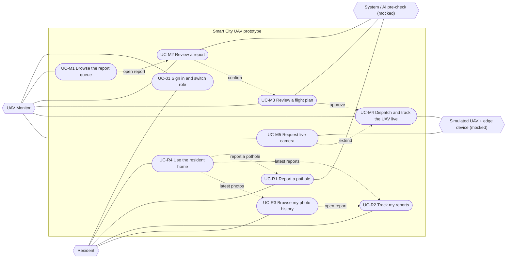

# Use cases: Smart City UAV for Pothole Detection (prototype)

COS40007 Group 1. Draft 0.3, 2026-11-05. Requirements, rules, decisions (D-xx) and the API contract:
[requirements.md](requirements.md).

Each use case has: goal, actors, Jira keys and FRs, precondition, main flow, alternative flows, postcondition,
screen (route), endpoints used, and **acceptance checks**. The checks are concrete items a reviewer can tick
against the running app and the code (ids like `R1.4` for reporting gaps).

Before checking: start the backend (`python -m run.serve --reload`, port 8000) and the frontend (`npm run dev`,
port 3000), then press "Reset demo" on `/`. Data is kept across backend restarts until "Reset demo" (D-03), so
reset first to get the seed state. Open the app at exactly `http://localhost:3000`: CORS allows only that
origin, so `127.0.0.1`, a LAN address or a real phone fail their API calls (A-22, G-17). Check at 1280 px and
375 px wide with the browser's device mode. Do not run `pytest`: it can change the demo photos (G-16).

**Text punctuation:** resident and banner texts may use a hyphen or an en dash. "Pothole found 87% - sent to
the UAV monitor" and "Pothole found 87% – sent to the UAV monitor" both pass (D-12).

## 1. Actors

| Actor | Kind | Description | In the prototype |
|---|---|---|---|
| Resident | Human, primary | Member of the public who reports potholes and follows their reports and photos. | Signs in with a name, no password. Sees only reports sent from this browser. |
| UAV Monitor | Human, primary | City operator who reviews reports and flight plans, launches the UAV and follows it. | Signs in with a name, no password. |
| System / AI pre-check | System, supporting | Runs the AI pre-check on each new photo and proposes flight plans. | **Mocked**: `MockDetector` and `FlightPlanner`. |
| Simulated UAV | System, supporting | Flies the approved plan, sends telemetry and camera, its edge device confirms the damage. | **Mocked**: time-based flight (45 s), fake edge results, simulated camera feed. Real drone data can enter through `POST /telemetry/ingest`. |

## 2. Use case list

| ID | Use case | Primary actor | Supporting actor | Jira | FRs | Routes |
|---|---|---|---|---|---|---|
| UC-01 | Sign in and switch role | Resident, UAV Monitor | - | None (prototype request) | FR-01 to FR-04, FR-37 | `/`, top bar, old `/report*` redirects |
| UC-R1 | Report a pothole | Resident | System / AI pre-check | SCRUM-24, 30, 23, 29 | FR-05 to FR-09 | `/resident/report` |
| UC-R2 | Track my reports | Resident | - | SCRUM-45 | FR-10 to FR-12 | `/resident/reports`, `/resident/reports/[id]` |
| UC-R3 | Browse my photo history | Resident | - | None (prototype request) | FR-40, FR-41 | `/resident/photos` |
| UC-R4 | Use the resident home | Resident | - | None (prototype request) | FR-37, FR-38, FR-39 | `/resident`, `/resident/home` |
| UC-M1 | Browse the report queue on the map | UAV Monitor | - | SCRUM-23, 29 | FR-13, FR-14 | `/monitor` |
| UC-M2 | Review a report | UAV Monitor | System (planner) | SCRUM-29, 37, 27 | FR-15 to FR-19 | `/monitor/reports/[id]` |
| UC-M3 | Review a flight plan | UAV Monitor | System (planner) | SCRUM-31, 27 | FR-19 to FR-24 | `/monitor/flight-plans/[id]` |
| UC-M4 | Dispatch and track the UAV live | UAV Monitor | Simulated UAV | SCRUM-33, 39, 34 | FR-25 to FR-32 | `/monitor/flight-plans/[id]`, `/monitor/dashboard` |
| UC-M5 | Request the UAV's live camera | UAV Monitor | Simulated UAV | SCRUM-39 | FR-33 to FR-36 | `/monitor/dashboard?mission=ID` |

## 3. Use case diagram

## 4. End-to-end flow (Task 1 activity diagram)

| # | Activity | Use case | Status after |
|---|---|---|---|
| 1 | Resident pins the pothole and sends a photo | UC-R4, UC-R1 | Report `submitted` |
| 2 | AI pre-check (mocked) | UC-R1 | Report `under_review`, or `no_damage` (closed) |
| 3 | Monitor finds and reviews the report | UC-M1, UC-M2 | Report `rejected` (closed), or plan `proposed` |
| 4 | Monitor reviews the flight plan | UC-M3 | Plan `approved` + mission `pending`; or `changes_needed` + new plan `proposed`; or `rejected` (report closed) |
| 5 | UAV flies (mocked) | UC-M4, UC-M5 | Report `uav_dispatched`; mission `takeoff`, `surveying`, `landing`, `done` |
| 6 | Edge device confirms (mocked) | UC-M4 | Report `confirmed` or `not_confirmed` |
| 7 | Dashboard and resident see the result | UC-M4, UC-R2, UC-R3, UC-R4 | - |

---

## UC-01 Sign in and switch role

- **Goal:** Get into the app as a Resident or a UAV Monitor in one step, and swap roles fast during a demo.
- **Primary actor:** Resident or UAV Monitor.
- **Jira / FRs:** none (prototype request) / FR-01, FR-02, FR-03, FR-04, FR-37.
- **Precondition:** The app is open in a browser. The backend runs (needed only for "Reset demo").

**Main flow**
1. The user opens `/`.
2. The system shows a name field, two role cards (Resident, UAV Monitor) and a "Reset demo" link.
3. The user types a name and picks a role card.
4. The system saves `{role, name}` in `localStorage` and opens the role home: `/resident/home` (Resident) or
   `/monitor` (UAV Monitor).
5. The top bar shows the app name, a Resident | Monitor switch and Sign out.
6. The user picks the other role in the switch.
7. The system changes the role and opens the other role home (`/resident/home` or `/monitor`). The name stays.
8. The user selects Sign out. The system clears the session and opens `/`.

**Alternative flows**
- **A1 Empty name:** the system does not sign in and shows "Enter your name" (A-15).
- **A2 Wrong page for the role:** a Resident opening `/monitor/**` is sent to `/resident/home`; a Monitor opening
  `/resident/**` is sent to `/monitor`. With no session, any page sends the user to `/`.
- **A3 Reset demo:** the user selects "Reset demo". The system calls `POST /dev/reset`, shows "Demo data reset",
  and clears "my reports" in `localStorage` (A-12). If the call fails, it shows the error. Without a reset, the
  data stays as it was, even after a backend restart (D-03).
- **A4 Reload:** the session survives a reload.
- **A5 Old links:** `/report` goes to `/resident/report`, `/report?tab=mine` to `/resident/reports`,
  `/report/{id}` to `/resident/reports/{id}`, and `/resident` to `/resident/home` (FR-37).

**Postcondition:** A session `{role, name}` is stored and the user is on the role home (or the session is
cleared after Sign out).

**Screen:** `/`; top bar on every page (`AppShell`), `RoleGate` on every role page.
**Endpoints:** `POST /dev/reset` (sign-in itself is client-side only).

**Acceptance checks**
- [ ] **01.1** `/` has a name field, a Resident card, a UAV Monitor card and a "Reset demo" link. No password field.
- [ ] **01.2** Resident card opens `/resident/home`; UAV Monitor card opens `/monitor`.
- [ ] **01.3** Empty name blocks sign-in.
- [ ] **01.4** After reload the user is still signed in with the same role and name.
- [ ] **01.5** The top bar holds only: app name, Resident / Monitor switch, Sign out. No settings, profile, avatar or other menu on any page.
- [ ] **01.6** Switching to Resident opens `/resident/home`; switching to Monitor opens `/monitor`. The name is not asked again.
- [ ] **01.7** Sign out clears the session and shows `/`; opening `/monitor` or `/resident/home` afterwards redirects to `/`.
- [ ] **01.8** Signed in as Resident, opening `/monitor` redirects to `/resident/home`; as Monitor, opening `/resident/home` (or any `/resident/**`) redirects to `/monitor`.
- [ ] **01.9** "Reset demo" calls `POST /dev/reset` (2xx), the seed reports show again on `/monitor`, and the resident's "my reports" is empty.
- [ ] **01.10** With the OS in dark mode, `/` and every other page stay light.
- [ ] **01.11** Old links redirect as a Resident: `/report` to `/resident/report`, `/report?tab=mine` to `/resident/reports`, `/report/{id}` to `/resident/reports/{id}`; `/resident` to `/resident/home`.
- [ ] **01.12** Restarting the backend without "Reset demo" keeps the reports created since the last reset.

---

## UC-R1 Report a pothole

- **Goal:** The resident tells the city where a pothole is, with a photo, and sees the AI pre-check result at once.
- **Primary actor:** Resident. **Supporting actor:** System / AI pre-check (mocked).
- **Jira / FRs:** SCRUM-24, SCRUM-30, SCRUM-23, SCRUM-29 / FR-05 to FR-09.
- **Precondition:** Signed in as Resident (UC-01). Backend running. Usually started from "Report a pothole" on
  `/resident/home` (UC-R4).

**Main flow**
1. The resident opens `/resident/report`.
2. The system asks the browser for its location, centres the full-screen map there and drops a pin.
3. The panel says "Pin the pothole". The resident drags the pin, or taps the map, onto the pothole.
4. The resident picks a photo.
5. The system checks the type (JPEG or PNG) and size (up to 10 MB) and shows a preview.
6. The resident selects "Send report". The button shows a busy state.
7. The system sends `POST /reports` with the pin's `lat`, `lon` and the photo.
8. The AI pre-check (mocked) runs on the server, stores the detections and sets the status to `under_review`.
9. The system shows the result card "<class label> found <confidence>% – sent to the UAV monitor" and a "Track
   this report" link to `/resident/reports/{id}`, and adds the report id to "my reports" in `localStorage`.

**Alternative flows**
- **A1 Location denied or unavailable:** the map opens at `MAP.defaultCenter` (10.7769, 106.7009); continue at step 3.
- **A2 Wrong file type or too big:** an error shows under the picker; "Send report" stays disabled; nothing is uploaded.
- **A3 No damage found:** at step 8 the status is `no_damage`; the card says "No damage found – report closed".
  The id is still saved in "my reports".
- **A4 Server error** (415 type, 413 size, 422 empty file, or a network error): the panel shows the `detail`
  message; the resident can try again; no id is saved.

**Postcondition:** A report exists with photo, `lat`, `lon`, server detections and status `under_review` or
`no_damage`. Its id is in "my reports", so it shows on `/resident/home`, `/resident/reports` and
`/resident/photos`. An `under_review` report is in the monitor's "Needs review" list.

**Screen:** `/resident/report`.
**Endpoints:** `POST /reports`.

**Acceptance checks**
- [ ] **R1.1** `/resident/report` is reachable only as Resident (`RoleGate role="resident"`); it has no "My reports" tab.
- [ ] **R1.2** The map centres on the browser location; with location blocked it centres on 10.7769, 106.7009.
- [ ] **R1.3** The pin can be dragged, and tapping the map moves it. The `lat` / `lon` sent in `POST /reports` are the pin's.
- [ ] **R1.4** Picking a non-JPEG/PNG file, or a file over 10 MB, shows an error and makes no network call.
- [ ] **R1.5** "Send report" is disabled until a valid photo is chosen; while sending it is busy and cannot be pressed twice.
- [ ] **R1.6** `POST /reports` answers 201; the status is `under_review` or `no_damage`, never `submitted`.
- [ ] **R1.7** Server detections in the answer have `source=server`, `deployment=server-fp32`, `model_version=mock-0.1`, class in D00 / D10 / D20 / D40.
- [ ] **R1.8** API check: `curl -F lat=10.77 -F lon=106.70 -F "photo=@notes.txt;type=text/plain" localhost:8000/reports` answers 415 with a `detail` message.
- [ ] **R1.9** Damage case shows "<class label> found <n>% – sent to the UAV monitor"; no-damage case shows "No damage found – report closed". A hyphen instead of the en dash also passes.
- [ ] **R1.10** "Track this report" opens `/resident/reports/{id}`.
- [ ] **R1.11** The new report then shows first in `/resident/reports`, in the latest reports and photo strip on `/resident/home`, and first in `/resident/photos`.
- [ ] **R1.12** Sending the same photo again gives the same pre-check result.
- [ ] **R1.13** The new `under_review` report shows on `/monitor` under "Needs review" within 10 s.
- [ ] **R1.14** At 375 px the panel is a bottom sheet, the map and pin still work, and there is no horizontal scroll.

---

## UC-R2 Track my reports

- **Goal:** The resident sees what happened to their reports, without reloading.
- **Primary actor:** Resident.
- **Jira / FRs:** SCRUM-45 / FR-10, FR-11, FR-12.
- **Precondition:** Signed in as Resident. At least one id in "my reports" (or a known report id).

**Main flow**
1. The resident opens `/resident/reports` (from "See all" on `/resident/home`).
2. The system loads each saved id with `GET /reports/{id}` and lists them newest first, each with a status chip.
   While one of them is still open, the list refreshes every 5 s.
3. The resident selects a report (here, from the home page's latest reports, or from "Open report" in the photo
   history).
4. The system opens `/resident/reports/{id}`: the map centred on the pin and the status timeline (table below).
5. The system polls `GET /reports/{id}` every 5 s and moves the timeline on when the status changes.
6. At a final status (`confirmed`, `not_confirmed`, `no_damage`, `rejected`) the timeline shows the end and
   polling stops.

| Report status | Timeline shows |
|---|---|
| `submitted` | Submitted (current) |
| `no_damage` | Submitted, AI check (done), end: "No damage found – closed" |
| `under_review` | Submitted, AI check (done), Under review (current) |
| `rejected` | Submitted, AI check, Under review (done), end: "Rejected" + reason (`review_note`) |
| `uav_dispatched` | ... Under review (done), UAV dispatched (current) |
| `confirmed` | ... UAV dispatched (done), end: "Confirmed" |
| `not_confirmed` | ... UAV dispatched (done), end: "Not confirmed" |

A rejected report shows the monitor's reason whether the monitor rejected the report (UC-M2) or its flight plan
(UC-M3, D-06).

**Alternative flows**
- **A1 No saved reports:** empty state "No reports yet" with a "Report a pothole" button to `/resident/report`.
- **A2 Report not found** (for example after Reset demo): `/resident/reports/{id}` shows "Report not found"; the
  list skips ids that no longer exist. No crash.
- **A3 Network error while polling:** the last known status stays, a small "Reconnecting..." note shows, polling goes on.

**Postcondition:** Nothing changes (read only).

**Screen:** `/resident/reports`, `/resident/reports/[id]`.
**Endpoints:** `GET /reports/{id}`.

**Acceptance checks**
- [ ] **R2.1** `/resident/reports` lists the reports sent from this browser, newest first, each with a status chip that has a text label.
- [ ] **R2.2** Selecting one opens `/resident/reports/{id}` with the map on the report's pin.
- [ ] **R2.3** The timeline has the steps Submitted, AI check, Under review, UAV dispatched, Confirmed / Not confirmed, and marks the current step as in the table.
- [ ] **R2.4** The network tab shows `GET /reports/{id}` about every 5 s while the status is not final.
- [ ] **R2.5** When the monitor launches the UAV for this report (UC-M4), `/resident/reports/{id}` shows "UAV dispatched" within 5 s without reload, then Confirmed or Not confirmed after the flight; the chip on `/resident/reports` changes the same way.
- [ ] **R2.6** A `no_damage` report ends after "AI check"; a `rejected` report shows "Rejected" and the reason (also when the monitor rejected the flight plan).
- [ ] **R2.7** Polling stops at a final status.
- [ ] **R2.8** `/resident/reports/99999` shows "Report not found".
- [ ] **R2.9** With no saved reports, `/resident/reports` shows an empty state with a way to `/resident/report`.
- [ ] **R2.10** Both pages get back to `/resident/home` in one tap.
- [ ] **R2.11** Works at 375 px with no horizontal scroll.

---

## UC-R3 Browse my photo history

- **Goal:** The resident looks back at the photos they sent, with each report's status, and opens any report
  from its photo.
- **Primary actor:** Resident.
- **Jira / FRs:** none (prototype request) / FR-40, FR-41.
- **Precondition:** Signed in as Resident.

**Main flow**
1. The resident opens `/resident/photos` (from the photo strip on `/resident/home`).
2. The system loads each id in "my reports" with `GET /reports/{id}` and shows the photos (`photo_url`) as a
   grid, newest first. Each tile shows the photo, a status badge and the date sent.
3. The resident taps a tile.
4. The system opens a larger view of the photo with its status, date and an "Open report" action.
5. The resident selects "Open report". The system opens `/resident/reports/{id}` (UC-R2).

**Alternative flows**
- **A1 No photos:** empty state "No photos yet" with "Report a pothole" to `/resident/report`.
- **A2 Close the larger view** (close button, Escape, or tap outside): back to the grid.
- **A3 Photo fails to load:** a placeholder shows in the tile; the badge and date still show; the tile still opens.
- **A4 Report gone** (404, for example after Reset demo): its tile is skipped.
- **A5 Network error:** a short message; the last grid stays; the next refresh tries again.

**Postcondition:** Nothing changes (read only).

**Screen:** `/resident/photos` (grid + larger view).
**Endpoints:** `GET /reports/{id}`; photos from `GET /media/...` (`photo_url`).

**Acceptance checks**
- [ ] **R3.1** `/resident/photos` is reachable only as Resident.
- [ ] **R3.2** The grid has one tile per report in "my reports" that still exists, newest first. Seed reports do not appear (they were not sent from this browser).
- [ ] **R3.3** Each tile shows the photo, a status badge with a text label, and the date sent.
- [ ] **R3.4** A photo sent in UC-R1 is the first tile.
- [ ] **R3.5** Tapping a tile opens a larger view of that photo with status, date and "Open report".
- [ ] **R3.6** "Open report" opens `/resident/reports/{id}` for that photo's report.
- [ ] **R3.7** The larger view can be closed and the grid shows again.
- [ ] **R3.8** A tile's badge matches the status on `/resident/reports/{id}` and changes without reload while that report is open (5 s refresh).
- [ ] **R3.9** With no reports (right after Reset demo) an empty state shows with a way to `/resident/report`.
- [ ] **R3.10** At 375 px the grid fits the width (no horizontal scroll) and the larger view fits the screen.
- [ ] **R3.11** The page gets back to `/resident/home` in one tap.

---

## UC-R4 Use the resident home

- **Goal:** One landing page where the resident starts a new report and sees at a glance how their reports are
  doing.
- **Primary actor:** Resident.
- **Jira / FRs:** none (prototype request) / FR-37, FR-38, FR-39.
- **Precondition:** Signed in as Resident.

**Main flow**
1. After sign-in, after switching to Resident, or when opening `/resident`, the system opens `/resident/home`.
2. The system loads "my reports" (`GET /reports/{id}` per saved id).
3. The page shows: a "Report a pothole" action; counts of my reports by status; my 3 latest reports (status
   chip, date) with a link to all of them; a strip of my latest photos with a link to the photo history.
4. The resident picks one: "Report a pothole" opens `/resident/report` (UC-R1); a report opens
   `/resident/reports/{id}` (UC-R2); "See all" opens `/resident/reports` (UC-R2); the photo strip leads to
   `/resident/photos` (UC-R3).
5. While one of my reports is still open, the counts and chips refresh every 5 s.

**Alternative flows**
- **A1 No reports yet:** an empty state invites the first report; "Report a pothole" still shows.
- **A2 Fewer than 3 reports:** the page shows the ones there are.
- **A3 Saved report gone** (404): left out of the counts and lists.
- **A4 Network error:** a short message; "Report a pothole" still works.

**Postcondition:** Nothing changes (read only).

**Screen:** `/resident/home` (`/resident` redirects here).
**Endpoints:** `GET /reports/{id}`; photos from `GET /media/...`.

**Acceptance checks**
- [ ] **R4.1** After sign-in as Resident, and after switching to Resident, the page is `/resident/home`; `/resident` redirects there.
- [ ] **R4.2** "Report a pothole" opens `/resident/report`.
- [ ] **R4.3** The counts by status (or by labelled status groups, A-19) each have a text label and add up to the number of my reports that still exist.
- [ ] **R4.4** At most 3 latest reports show, newest first, each with a status chip and date; selecting one opens `/resident/reports/{id}`; a "See all" link opens `/resident/reports`.
- [ ] **R4.5** The photo strip shows my latest photos, newest first, and leads to `/resident/photos` (a single photo may open its larger view or its report).
- [ ] **R4.6** After sending a report (UC-R1), `/resident/home` shows it first in the latest reports and the photo strip, and the counts include it.
- [ ] **R4.7** When the monitor launches the UAV for one of my reports, its chip and the counts change within about 5 s without reload.
- [ ] **R4.8** With no reports (right after Reset demo) an empty state shows and "Report a pothole" still works.
- [ ] **R4.9** The top bar is unchanged (app name, switch, Sign out); the home is a page, not a menu; no settings or profile entries.
- [ ] **R4.10** At 375 px everything fits with no horizontal scroll.

---

## UC-M1 Browse the report queue on the map

- **Goal:** The monitor sees all reports on one map and finds the ones that need action.
- **Primary actor:** UAV Monitor.
- **Jira / FRs:** SCRUM-23, SCRUM-29 / FR-13, FR-14.
- **Precondition:** Signed in as UAV Monitor.

**Main flow**
1. The monitor opens `/monitor`.
2. The system loads `GET /reports` and shows every report as a pin coloured by status, and as a list in the
   floating panel, newest first (id, status chip, top class + confidence, time).
3. The "Needs review" chip is selected by default.
4. The monitor picks a filter chip. Pins and list show only the matching reports (table below).
5. The monitor selects a row (or a pin). The map flies to the pin and highlights it.
6. The monitor opens the report: `/monitor/reports/{id}` (UC-M2).
7. While the page is open, the queue refreshes every 10 s.

| Chip | Shows reports with |
|---|---|
| Needs review | `submitted`, or `under_review` with `latest_plan_status` not `proposed` / `approved` |
| Flight plans | `under_review` with `latest_plan_status` `proposed`, or `approved` (mission still `pending`) |
| In flight | `uav_dispatched` |
| Done | `no_damage`, `rejected`, `confirmed`, `not_confirmed` |

The split comes from `Report.latest_plan_status` in `GET /reports` (D-04); no per-report calls.

**Alternative flows**
- **A1 Empty chip:** empty state, for example "Nothing needs review".
- **A2 API error:** a short message in the panel; the next refresh tries again.

**Postcondition:** Nothing changes (read only).

**Screen:** `/monitor`.
**Endpoints:** `GET /reports` (optional `?status=`).

**Acceptance checks**
- [ ] **M1.1** `/monitor` is reachable only as UAV Monitor (`RoleGate role="monitor"`).
- [ ] **M1.2** Full-screen map (CARTO light tiles, attribution shown) with one floating panel.
- [ ] **M1.3** Every report shows as a pin under its chip (the default "Needs review" chip shows only its own pins); the pin colour depends on the status, and the status is also shown as text in the list.
- [ ] **M1.4** Chips Needs review, Flight plans, In flight, Done exist and filter both pins and list as in the table.
- [ ] **M1.5** Right after Reset demo: Needs review 2, Flight plans 1, In flight 1 (it lands within about 35 s), Done 4.
- [ ] **M1.6** Selecting a row flies the map to its pin.
- [ ] **M1.7** Opening a row goes to `/monitor/reports/{id}`.
- [ ] **M1.8** A report sent by a resident (UC-R1) shows within 10 s without reload.
- [ ] **M1.9** Each refresh is one `GET /reports` call (no `GET /reports/{id}/flight-plans` per report).
- [ ] **M1.10** At 375 px the list is a bottom sheet over the map; no horizontal scroll.

---

## UC-M2 Review a report

- **Goal:** The monitor checks the AI result, marks wrong boxes, then confirms the report (which proposes a
  flight plan) or rejects it with a reason.
- **Primary actor:** UAV Monitor. **Supporting actor:** System (flight planner, mocked).
- **Jira / FRs:** SCRUM-29, SCRUM-37, SCRUM-27 / FR-15 to FR-19.
- **Precondition:** Signed in as UAV Monitor. The report exists. For the actions: status `under_review` (BR-03).

**Main flow**
1. The monitor opens `/monitor/reports/{id}`.
2. The system loads `GET /reports/{id}` and shows the photo (a real JPEG for the damage seeds, D-13) with a box
   per server detection, and one row per detection: class name, confidence, model version, frame id, "Wrong
   detection".
3. (Optional) The monitor selects "Wrong detection" on a row. The system calls `POST /detections/{detId}/flag`;
   the row shows "Flagged".
4. The monitor selects "Confirm & propose flight plan".
5. The system calls `PATCH /reports/{id}/review` with `{confirmed: true}`, then `POST /reports/{id}/flight-plan`.
6. The planner (mocked) builds the route; the plan is `proposed`.
7. The system opens `/monitor/flight-plans/{planId}` (UC-M3).

**Alternative flows**
- **A1 Reject:** the monitor selects "Reject". A dialog asks for a reason (required). The monitor types it and
  confirms. The system calls `PATCH /reports/{id}/review` with `{confirmed: false, note}`. The report becomes
  `rejected`; a `proposed` plan of the report becomes `rejected` too. The page turns read-only and shows
  "Rejected" and the reason. The resident sees it on `/resident/reports/{id}` (UC-R2).
- **A2 Empty reason:** the dialog's confirm button stays disabled; no request is sent.
- **A3 Report not `under_review`:** the actions are hidden; the page is read-only and shows the status. If
  `latest_plan_id` is set, "Open flight plan" goes to `/monitor/flight-plans/{latest_plan_id}`; if the report
  is `uav_dispatched` or done with a `mission_id`, "Open live dashboard" goes to
  `/monitor/dashboard?mission={mission_id}`.
- **A4 All boxes flagged:** the monitor can still confirm or reject; flags are feedback for retraining, not a decision.
- **A5 No detections** (`no_damage`; the seed photo is `clean-road.svg`): the photo shows without boxes
  and the text "No damage found by the AI"; read-only.
- **A6 API error** (for example 409 because the report already has an approved plan): the message shows near
  the buttons; the buttons work again.

**Postcondition:** Confirm: a `proposed` plan exists for the report; the report stays `under_review`. Reject:
the report is `rejected` with the reason. Flag: the detection has `flagged_wrong = true`.

**Screen:** `/monitor/reports/[id]`.
**Endpoints:** `GET /reports/{id}`, `POST /detections/{id}/flag`, `PATCH /reports/{id}/review`,
`POST /reports/{id}/flight-plan`. The links in A3 use `latest_plan_id` and `mission_id` from the report (D-04).

**Acceptance checks**
- [ ] **M2.1** The photo shows one box per server detection, in the right place at both 1280 px and 375 px (scaled by the image's natural size). On the real JPEG seed photos the boxes sit on the damage.
- [ ] **M2.2** Each row shows class name, confidence in %, model version and frame id.
- [ ] **M2.3** "Wrong detection" calls `POST /detections/{id}/flag`; the row shows "Flagged" and is still flagged after reload.
- [ ] **M2.4** "Confirm & propose flight plan" sends `PATCH /reports/{id}/review` `{confirmed: true}` then `POST /reports/{id}/flight-plan`, and lands on `/monitor/flight-plans/{planId}` with a `proposed` plan.
- [ ] **M2.5** Reject without a reason is blocked: no request is sent.
- [ ] **M2.6** Reject with a reason: report `rejected`, `review_note` = the reason; `/resident/reports/{id}` shows "Rejected" and the reason.
- [ ] **M2.7** Confirm and Reject show only for `under_review` reports; other statuses are read-only with the "Open flight plan" / "Open live dashboard" links where they apply.
- [ ] **M2.8** API check: `PATCH /reports/{id}/review` with `{"confirmed": false}` and no note answers 422.
- [ ] **M2.9** API check: `PATCH /reports/{id}/review` on a `rejected` report answers 409; rejecting a report whose plan is approved answers 409.
- [ ] **M2.10** API check: rejecting the seed report that has a `proposed` plan also turns that plan `rejected` ("Report rejected: <reason>").
- [ ] **M2.11** Works at 375 px; the photo fits the width.

---

## UC-M3 Review a flight plan

- **Goal:** The monitor decides on the proposed route before any flight: approve, request changes, or reject,
  and sees the decision history.
- **Primary actor:** UAV Monitor. **Supporting actor:** System (flight planner, mocked).
- **Jira / FRs:** SCRUM-31, SCRUM-27 / FR-19 to FR-24.
- **Precondition:** A plan exists (from UC-M2). For the decisions: plan `proposed` (BR-02).

**Main flow**
1. The monitor is on `/monitor/flight-plans/{id}`.
2. The system loads `GET /flight-plans/{id}` and `GET /reports/{report_id}`, and draws the route line, the
   takeoff and landing icons, the survey circle and the target pin.
3. The panel shows drone, altitude, survey radius, route distance (`distance_m`), estimated time
   (`estimated_duration_s`, 45 s) and status, and the decision history from `GET /reports/{report_id}/flight-plans`.
4. The monitor selects "Approve".
5. The system calls `POST /flight-plans/{id}/approve`. The plan becomes `approved` with `decided_at`, a mission
   is created in `pending`, and the answer carries `mission_id`.
6. The panel shows "Approved" and a "Launch UAV" button (continues in UC-M4).

**Alternative flows**
- **A1 Request changes:** the monitor selects "Request changes", types a reason (required) and confirms. The
  system calls `POST /flight-plans/{id}/request-changes` `{reason}`. The old plan becomes `changes_needed`; the
  answer is the new `proposed` plan (different altitude or radius). The system opens it; the history shows both.
- **A2 Reject:** the monitor selects "Reject", types a reason (required) and confirms. The system calls
  `POST /flight-plans/{id}/reject` `{reason}`. The plan becomes `rejected`; no mission is created; the report is
  closed as `rejected` with the plan reason (D-06). The page turns read-only.
- **A3 Empty reason:** the dialog's confirm button stays disabled; no request is sent.
- **A4 Plan not `proposed`:** the decision buttons are hidden; the panel shows the decision, reason and time.
  If the plan is `approved` and its mission (`mission_id`) is still `pending`, "Launch UAV" stays available. If
  the mission has started, "Open live dashboard" shows instead.
- **A5 Old version:** selecting an older plan in the history opens it read-only.

**Postcondition:** Approve: plan `approved`, mission `pending`. Request changes: old plan `changes_needed`, new
plan `proposed`. Reject: plan `rejected`, no mission, report `rejected`.

**Screen:** `/monitor/flight-plans/[id]`.
**Endpoints:** `GET /flight-plans/{id}`, `GET /reports/{id}`, `GET /reports/{id}/flight-plans`,
`POST /flight-plans/{id}/approve`, `POST /flight-plans/{id}/request-changes`, `POST /flight-plans/{id}/reject`;
`GET /missions/{mission_id}` (state of the mission for A4).

**Acceptance checks**
- [ ] **M3.1** The map shows the route line, takeoff and landing icons, and the survey circle around the target pin.
- [ ] **M3.2** The panel shows drone id (`sim-uav-1`), altitude (30 m), survey radius (25 m), route distance (from `distance_m`), estimated time (from `estimated_duration_s`, 45 s) and status.
- [ ] **M3.3** Before approval the plan's `mission_id` is null and no mission exists for it.
- [ ] **M3.4** Approve: plan `approved` with `decided_at` and a `mission_id`; `GET /missions/{mission_id}` is `pending`; "Launch UAV" shows.
- [ ] **M3.5** Request changes and Reject both open a reason dialog; an empty reason is blocked.
- [ ] **M3.6** Request changes: the old plan is `changes_needed` with the reason; a new `proposed` plan has a different altitude or radius; the page shows the new plan.
- [ ] **M3.7** The history lists every plan of the report, newest first, with status, reason and decision time.
- [ ] **M3.8** Reject: plan `rejected`, no mission, no "Launch UAV"; the report is `rejected` and `/resident/reports/{id}` shows the plan reason.
- [ ] **M3.9** Decision buttons show only for a `proposed` plan.
- [ ] **M3.10** API check: `POST /flight-plans/{id}/reject` with `{"reason": ""}` or `{"reason": "  "}` answers 422; approving a plan that is not `proposed` answers 409.
- [ ] **M3.11** Works at 375 px.

---

## UC-M4 Dispatch and track the UAV live

- **Goal:** The monitor launches the approved mission, follows the UAV live (position, route to target, battery,
  gimbal, waypoint, signal), and sees whether the edge device confirmed the pothole.
- **Primary actor:** UAV Monitor. **Supporting actor:** Simulated UAV (mock flight + mock edge device).
- **Jira / FRs:** SCRUM-33, SCRUM-39, SCRUM-34 (mocked) / FR-25 to FR-32.
- **Precondition:** An approved plan with a `pending` mission (UC-M3).

**Main flow**
1. The monitor selects "Launch UAV" on the plan page.
2. The system calls `POST /missions/{mission_id}/dispatch`. The mission starts (`takeoff`, `started_at` set)
   and the report becomes `uav_dispatched`.
3. The system opens `/monitor/dashboard?mission={id}`.
4. The dashboard loads the mission (`GET /missions/{id}`), its plan (`GET /flight-plans/{flight_plan_id}`) and
   report (`GET /reports/{report_id}`). It draws the planned route (dashed), the target pin with its survey
   circle, and the home marker (H).
5. Every 1 s the dashboard reads `GET /missions/{id}/telemetry/latest`. The UAV marker moves and rotates by
   heading, the flown trail grows, the next waypoint is highlighted, and the camera cone follows the gimbal yaw.
6. The panel updates: drone id, "In mission" chip, stepper (takeoff / surveying / landing / done), progress
   bar, "Waypoint n / total", "Last update n s ago", and the grid: altitude, distance to target, distance to
   home, heading compass, battery bar, gimbal pitch / yaw / roll.
7. The monitor can turn on "Follow UAV" (map keeps the UAV centred) or press "Fit route".
8. After 45 s the mission is `done`. The mock edge device stores its detections, and the report becomes
   `confirmed` or `not_confirmed`.
9. The panel shows the result badge and the edge detections from `GET /missions/{id}/detections`. Telemetry
   polling stops.

**Alternative flows**
- **A1 No mission in the URL:** `/monitor/dashboard` lists active missions (`GET /missions?active=true`:
  `pending` and flying) with drone id (`MissionOut.drone_id`), state and battery (from each mission's latest
  telemetry; a pending UAV is parked at home), refreshed every 3 s. Selecting one continues at step 4. With
  none: "No UAV in the air".
- **A2 Not confirmed:** the badge says "Not confirmed" and the edge list says "No damage seen by the UAV".
- **A3 Signal lost:** the latest `ts` is older than 3 s, or the request fails: the panel shows "Signal lost"
  instead of the age; the marker stays at its last position (TR-02).
- **A4 Low battery:** below 40% the bar turns amber; below 20% it turns red and a "Battery low – return home"
  banner shows (TR-01). Warning only. With the mock flight this is reached only through ingest (A5).
- **A5 Real drone data:** a drone posts its raw JSON to `POST /telemetry/ingest` with `droneID` = the mission's
  drone (`sim-uav-1`). The dashboard shows that sample for 5 s (`MOCK.ingest_hold_s`, D-02), with heading
  normalised and distance to home recomputed; then the simulation takes over again.
- **A6 Reload during flight:** the flight goes on (time-based). The trail starts again from the current point (A-13).
- **A7 Mission not found:** "Mission not found" and a link to the active missions list.
- **A8 Dispatch on a mission that is not `pending`:** the API answers 409; the UI shows the message.

**Postcondition:** Mission `done` with `finished_at`. Edge detections stored for the mission. Report
`confirmed` or `not_confirmed`; the resident sees it on `/resident/reports/{id}`, `/resident/home` and
`/resident/photos` (if the report was sent from that browser).

**Screen:** `/monitor/flight-plans/[id]` ("Launch UAV"), `/monitor/dashboard?mission=ID`, `/monitor/dashboard`.
**Endpoints:** `POST /missions/{id}/dispatch`, `GET /missions/{id}`, `GET /missions?active=true`,
`GET /flight-plans/{id}`, `GET /reports/{id}`, `GET /missions/{id}/telemetry/latest`,
`GET /missions/{id}/detections`; `POST /telemetry/ingest` (A5).

**Acceptance checks**
- [ ] **M4.1** "Launch UAV" shows only for an approved plan with a `pending` mission; it calls dispatch with the plan's `mission_id` and opens `/monitor/dashboard?mission={id}`.
- [ ] **M4.2** After dispatch: report `uav_dispatched`; mission in `takeoff` with `started_at`.
- [ ] **M4.3** The network tab shows `GET /missions/{id}/telemetry/latest` about every 1 s while flying, and no more after `done`.
- [ ] **M4.4** Map: the UAV marker moves along the dashed route and rotates with heading; a solid trail grows behind it; the next waypoint is highlighted; home "H" marker; target pin with survey circle; camera cone in the gimbal yaw direction.
- [ ] **M4.5** "Follow UAV" keeps the UAV centred; "Fit route" shows the whole route. Both float on the map.
- [ ] **M4.6** The stepper goes takeoff, surveying, landing, done in order; the progress bar rises to 100%; "Waypoint n / total" counts up.
- [ ] **M4.7** Battery falls from 95% to 60%; gimbal pitch is -90 deg while surveying and -30 deg in transit; the heading compass turns.
- [ ] **M4.8** "Last update n s ago" shows; stopping the backend shows "Signal lost" after more than 3 s.
- [ ] **M4.9** About 45 s after launch: mission `done`, a Confirmed or Not confirmed badge, edge detections listed (`deployment=jetson-int8`), and the report has the matching final status.
- [ ] **M4.10** The resident's `/resident/reports/{id}` page for that report shows the final status without reload.
- [ ] **M4.11** `/monitor/dashboard` without `?mission` lists active missions (pending and flying) with drone id, state and battery; selecting one opens it.
- [ ] **M4.12** Ingest: during a flight, `curl -X POST localhost:8000/telemetry/ingest -H 'Content-Type: application/json' -d '<sample JSON from requirements 8.1 with "droneID": "sim-uav-1">'` answers 201, and the dashboard shows the sample's values for about 5 s, then the simulation again.
- [ ] **M4.13** In that ingest, heading -92.0 shows as 268 deg, and distance to home is recomputed (about 5,700 km), not 0.
- [ ] **M4.14** Ingest with `batteryPercentage` 30 shows an amber bar; with 15 a red bar and the "return home" banner (visible during the 5 s hold).
- [ ] **M4.15** Ingest with `"droneID": "drone1"` (unknown) answers 404; ingest for `sim-uav-1` with no flying mission answers 404.
- [ ] **M4.16** At 375 px the panel is a bottom sheet and the map controls can be reached.

---

## UC-M5 Request the UAV's live camera

- **Goal:** The monitor sees what the UAV camera sees during the mission (simulated in the prototype).
- **Primary actor:** UAV Monitor. **Supporting actor:** Simulated UAV.
- **Jira / FRs:** SCRUM-39 (prototype addition) / FR-33 to FR-36.
- **Precondition:** The dashboard is open for a mission (UC-M4).

**Main flow**
1. While the mission is `takeoff`, `surveying` or `landing`, the camera card shows "Request live camera" (enabled).
2. The monitor selects it.
3. The system calls `POST /missions/{id}/camera/request`. The session is `requested`; the card shows
   "Waiting for drone...".
4. The system polls `GET /missions/{id}/camera` every 2 s.
5. About 2 s later the session is `live`. The card shows the simulated feed: a road photo with a HUD
   (crosshair, altitude, gimbal pitch, time) and a "SIMULATED" label, plus "Stop camera".
6. The monitor selects "Stop camera". The system calls `POST /missions/{id}/camera/stop`. The session is
   `ended`; the card shows "Request live camera" again. Camera polling stops.

**Alternative flows**
- **A1 Mission ends while requested or live:** the session becomes `ended`. The feed goes away and the card
  becomes one "Camera ended" line with the request button disabled, under the result (D-10).
- **A2 Not flying** (`pending` or `done`): the button is disabled. If the API is called anyway, it answers
  HTTP 200 with `status: "denied"` (D-01) and the card shows "Camera not available – the UAV is not flying".
  The denial is not stored.
- **A3 Request again:** after stop, while still flying, the monitor can request again (`requested`).
- **A4 Real stream later:** if `stream_url` is set, the card plays it in a `<video>` instead of the simulated feed.

**Postcondition:** The session is `ended` (stopped, or the mission finished); a denied request leaves the
session as it was.

**Screen:** `/monitor/dashboard?mission=ID` (live camera card in the panel).
**Endpoints:** `POST /missions/{id}/camera/request`, `GET /missions/{id}/camera`,
`POST /missions/{id}/camera/stop`; `GET /missions/{id}/telemetry/latest` (HUD values).

**Acceptance checks**
- [ ] **M5.1** "Request live camera" is enabled only while the mission is `takeoff`, `surveying` or `landing`; disabled when `pending` or `done`.
- [ ] **M5.2** Selecting it sends `POST /missions/{id}/camera/request`; the card shows "Waiting for drone...".
- [ ] **M5.3** Within about 2 to 4 s the card shows the simulated feed with crosshair, altitude, gimbal pitch, time and a "SIMULATED" label.
- [ ] **M5.4** The network tab shows `GET /missions/{id}/camera` about every 2 s while `requested` or `live`, and not otherwise.
- [ ] **M5.5** "Stop camera" sends `POST /missions/{id}/camera/stop`; status `ended`; the request button works again while flying.
- [ ] **M5.6** If the mission ends while live, `GET /missions/{id}/camera` returns `ended` and the card is one "Camera ended" line with the button disabled.
- [ ] **M5.7** API check: `POST /missions/{id}/camera/request` on a `pending` or `done` mission answers HTTP 200 with `status: "denied"`; a following `GET /missions/{id}/camera` still shows the earlier status (`idle` or `ended`).
- [ ] **M5.8** Code check: with `stream_url` null no `<video>` is rendered; with a URL, a `<video>` plays it.

---

## 5. Decisions that affect these checks

Full list with sources: [requirements.md section 13](requirements.md#13-decisions-since-draft-01).

| ID | Decision | Checks |
|---|---|---|
| D-01 | Camera request while not flying: HTTP 200 with `status: "denied"`, not stored. | M5.7 |
| D-02 | A drone ingest sample holds for `MOCK.ingest_hold_s` = 5 s; ingest takes `state` from the mission. | M4.12, M4.14 |
| D-03 | Demo data survives backend restarts; seeded only on first start or "Reset demo". | 01.9, 01.12 |
| D-04 | `Report` carries `latest_plan_id`, `latest_plan_status`, `mission_id`. | M1.4, M1.9, M2.7 |
| D-05 | `FlightPlan` carries `mission_id`, `distance_m`, `estimated_duration_s`. | M3.2, M3.3, M3.4, M4.1 |
| D-06 | Plan reject closes the report as `rejected` with the plan reason. | M3.8, R2.6 |
| D-07 | Report reject needs a note (422), rejects a proposed plan, and is refused after approval (409). | M2.8, M2.9, M2.10 |
| D-08 | Active missions = `pending` + flying; `MissionOut` has `drone_id`. | M4.11 |
| D-10 | At `done` the camera card is one "Camera ended" line with a disabled button. | M5.6 |
| D-11 | Resident pages under `/resident`; old links redirect; resident home `/resident/home`; no "My reports" tab. | 01.2, 01.6, 01.8, 01.11, R1.1, R2.*, R3.*, R4.* |
| D-12 | Hyphen or en dash both pass in resident and banner texts. | R1.9, R2.6, M4.14 |
| D-13 | Seed photos are real JPEG pothole photos (`pothole-1.jpg` to `pothole-4.jpg`, `image_size` per report, boxes checked); the `no_damage` seed uses `clean-road.svg` until a clean-road photo is supplied. | M2.1, UC-M2 A5 |

No open gap blocks a check (G-12 is closed). Known limitations a reviewer should not report as failures
([requirements.md section 14](requirements.md#14-contract-gaps-and-known-limitations)):
- **G-13** The resident pages make one `GET /reports/{id}` call per saved report.
- **G-14** An upload over 10 MB is fully received before the 413 answer.
- **G-15** EXIF orientation is not applied: a rotated phone photo sent in UC-R1 can show its boxes in the wrong
  place on `/monitor/reports/{id}` (M2.1 is checked on the seed photos). GPS and other EXIF data stay in the stored photo.
- **G-16** `pytest` is not run.
- **G-17** The app works only at `http://localhost:3000`.

## 6. Demo walk-through (all use cases)

One pass that touches every use case, in this order (from the plan's verification step):

1. `/`: Reset demo, sign in as Resident; you land on `/resident/home` with an empty state (UC-01, UC-R4).
2. "Report a pothole": pin + photo, Send, see the pre-check result ("... found n% – sent to the UAV monitor" or
   "No damage found – report closed") (UC-R1).
3. Back on `/resident/home`: the report is in the latest reports, the photo strip and the counts. Open
   `/resident/photos`, tap the tile, "Open report": the timeline on `/resident/reports/{id}` (UC-R4, UC-R3, UC-R2).
4. Switch to Monitor; the report is under "Needs review" on `/monitor` (UC-M1).
5. Open it on `/monitor/reports/{id}`: the JPEG seed photos show their boxes. Flag a box, Confirm & propose flight
   plan (UC-M2).
6. Request changes with a reason, see the new plan and the history, Approve (UC-M3).
7. Launch UAV, watch the dashboard: battery drains, gimbal and waypoint change, trail grows (UC-M4).
8. Request live camera: requested, live, then "Camera ended" when the mission is done; the button is disabled
   after landing (UC-M5).
9. See Confirmed / Not confirmed. Switch to Resident: `/resident/home`, `/resident/reports/{id}` and
   `/resident/photos` show the final status without reload (UC-M4, UC-R2, UC-R3, UC-R4).
10. During a second flight, send the ingest `curl` with `"droneID": "sim-uav-1"`; the dashboard shows it for
    about 5 s (UC-M4 A5).
11. Check that both reject paths need a reason, the old `/report` links redirect, there is no dark mode, and
    there are no settings / profile buttons.
12. Restart the backend without "Reset demo": the reports from this pass are still there (D-03).
